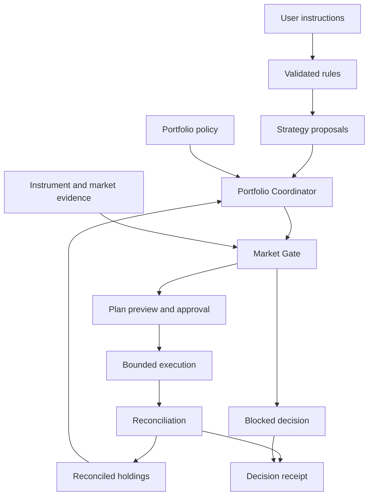
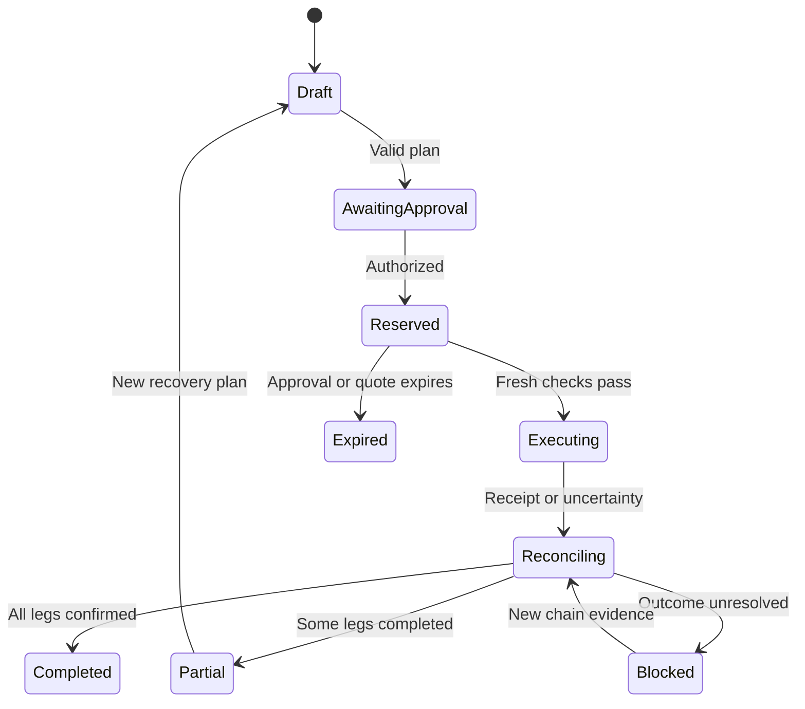

# Nexus — Coordinated Portfolios for Tokenized Stocks

**Product and engineering redesign · September 25, 2026 · Version 1.0**

**Status:** Proposed architecture, not implemented or audited. Replaces the EquiPilot concept with a portfolio-first design. Numerical thresholds below are illustrative configuration, not investment recommendations or verified liquidity assumptions.

## 1. Product decision

**Nexus turns investment instructions into one coordinated, inspectable portfolio plan for tokenized stocks on BNB Smart Chain.**

**Tagline:** Many strategies. One portfolio plan.

The user can schedule a stock basket, add a conditional rule, and set earnings restrictions. Nexus resolves competing instructions, checks the actual instruments and execution conditions, previews the resulting portfolio, and executes only within the approved authorization.

The defining feature is coordination. A basket buying NVDA and an earnings rule selling NVDA must not independently spend the same cash or trade against one another.

### Primary user and job

Start with a self-directed investor who already holds stablecoins and wants recurring exposure to a small set of tokenized equities, with understandable controls around concentration and earnings. This is a narrower initial audience than professional traders, arbitrary external agents, or every non-crypto investor.

**User job:** “Keep investing according to my plan, explain any adjustment, and never let separate automations contradict my limits.”

Nexus is a spot portfolio application. The initial product has no leverage, derivatives, pooled fund shares, proprietary token, or promise of returns. Access must respect each supported instrument’s actual restrictions; a wallet connection does not establish eligibility.

### Positioning grounded in the competitive research

Conversational stock trading and earnings-triggered workflows already appear in Binance Agentic Wallet documentation [1]. AI trading, portfolio tools, and DCA also have BNB ecosystem precedents. Nexus should therefore claim a specific experience it can demonstrate: **coordinated strategies, explicit execution permissions, and recoverable basket operations**. Do not claim to be the first AI portfolio manager or the only product with these capabilities.

## 2. Wire the four priorities into one pipeline

| Priority | Nexus component | Input → output | User-visible benefit |
|---|---|---|---|
| Portfolio-wide allocation and conflict resolution | Portfolio Coordinator | Strategy proposals + reconciled holdings + policy → one feasible plan | Strategies share a budget and cannot silently oppose one another |
| Equity-aware execution | Instrument Registry + Market Gate | Exact token identity + fresh market evidence → eligibility and bounds | A familiar ticker cannot conceal a different issuer, stale reference, or halted token |
| Inspectable automation | Rule Compiler + Decision Record | User instruction → validated rule → preview → authorization → receipt | Users see what the system understood and why it acted or refused |
| Reliable basket operations | Batch Controller + Reconciler | Approved plan → bounded execution → verified holdings → recovery decision | Partial execution and retries have explicit outcomes |

The Decision Record spans every stage. It is not an explanation generated after a trade.



**Authority rule:** Strategy modules emit proposals, never executable wallet commands. All execution passes through a single per-portfolio coordinator and an explicit authorization boundary.

## 3. Replace three independent modes with portfolio instructions

### 3.1 Accumulate

Create a basket, set target weights, contribute on a schedule, and optionally rebalance after drift exceeds a threshold. Schedule evaluation creates a proposal; it does not guarantee a trade at that time.

### 3.2 Conditional rules

Natural language compiles into a small typed rule language. The first version supports schedules, price thresholds, target weights, and exposure limits. Unsupported requests remain drafts with a precise explanation of the missing data or capability.

“Rotate defensively when volatility spikes” is incomplete. The user must confirm the volatility measure, threshold, source, eligible destination instruments, allocation, and duration before activation. The LLM cannot invent those values.

### 3.3 Event controls

The MVP uses earnings as an exposure-control input: freeze new purchases or propose a reduction around a confirmed event. Predictive pre-earnings entries and post-event exits are deferred until calendar reliability and strategy attribution are demonstrated.

An event exit must specify whether it reduces a dedicated strategy allocation or the entire company exposure. It must never interpret “close the earnings trade” as “sell everything the basket accumulated.” Strategy allocations are accounting records over the same holdings, not separate custodial accounts.

## 4. Portfolio Coordinator

### 4.1 Authoritative state

Maintain two distinct forms of truth:

- **Chain state:** assets, raw balances, approvals, transaction outcomes, contract nonces and policy versions.
- **Application state:** activated rules, logical strategy allocations, reservations, evidence snapshots, pending plans, and explanations.

The application reconciles against chain state. Cached Wallet API balances are useful for display and discovery, but the execution path must read the relevant balances and authorization state at a known block. Missing or unexplained state blocks new execution.

Use a transactional database for plans, reservation changes, and an outbox. Workers may receive events more than once. Idempotency keys, unique constraints, and reconciliation make processing safe; a message queue alone does not provide exactly-once execution.

### 4.2 Deterministic planning order

1. Lock one portfolio for planning and load its current revision.
2. Reconcile confirmed holdings and unresolved transactions. An unresolved transaction blocks conflicting execution.
3. Load the active policy, instrument mappings, event records, and eligible proposals for this decision window.
4. Apply owner pause, authorization constraints, and execution eligibility.
5. Translate mandatory exposure reductions into constraints. A strategy cannot override them with a higher confidence score.
6. Apply user-configured strategy priorities. Defaults: required exposure reductions, maintenance/rebalancing, scheduled accumulation, optional tactical entries.
7. Net compatible buy and sell proposals for the **same exact instrument**. Aggregate different wrappers of the same company for exposure checks, but do not silently exchange one wrapper for another.
8. Allocate remaining cash deterministically: priority first, then proportional allocation within the same priority, then stable ID ordering for rounding ties.
9. Evaluate all proposed holdings together against company, sector, issuer, and cash constraints. Recompute after actual route costs are available.
10. Record proposed, accepted, reduced, and rejected amounts. Reserve cash and sell inventory transactionally, then issue the plan revision.

If constraints cannot all be satisfied, produce a blocked or reduced plan with explicit reasons. Do not silently relax a limit. Required reductions still depend on executable liquidity; Nexus can report a breach without being able to cure it.

### 4.3 Budgeting and concurrency

`available cash = confirmed settlement-token balance − existing reservations − minimum cash reserve − conservative fee allowance`

Native gas is a separate balance and budget. Do not assume a settlement-token reserve pays BNB gas.

Check concentration using conservative projected values: upper-bound the exposure numerator and lower-bound total portfolio value. Record valuation time and source. Stablecoin depegs, unpriced assets, and instrument multipliers invalidate naive dollar calculations.

Only one batch may be in execution per portfolio in the MVP. External deposits, withdrawals, or manual trades increment the reconciled revision and invalidate pending plans. A database lock cannot stop an owner from using their wallet elsewhere.

### 4.4 Worked conflict example

Assume a $1,000 portfolio, $200 cash, $280 NVDA exposure, and $120 AMD exposure. Fees are omitted only for this illustration. A confirmed event overlay caps NVDA at 25%; the semiconductor cap is 40%.

| Proposal | Requested change | Coordinator decision |
|---|---:|---|
| Scheduled basket | Buy $60 NVDA | Reject while the event cap is active |
| Earnings control | Reduce NVDA to $250 | Accept $30 sell |
| Tactical rule | Buy $50 AMD | Reduce to $30 buy |

The combined result is NVDA $250, AMD $150, and cash $200, before costs: 25% NVDA and 40% semiconductors. The sell is confirmed before the subsequent buy is planned; each execution also needs valid market evidence and authorization. The decision record explains that $60 of accumulation was blocked and $20 of tactical demand was clipped.

If NVDA is halted, the planned reduction does not count as completed. The system does not execute the AMD purchase on the assumption that the sale will eventually succeed.

## 5. Instrument Registry and Market Gate

### 5.1 Identity model

A ticker is a search label, not an execution identifier.

| Field | Purpose |
|---|---|
| `instrumentId` | Internal immutable identity for chain + token contract + issuer/product |
| `underlyingId` | Groups wrappers that track the same company or fund |
| `chainId`, `tokenAddress`, `decimals` | Exact execution and quantity identity |
| `issuerId`, `productType` | Distinguishes legal/product exposure and counterparty concentration |
| `quantityModel`, `adapterVersion` | Describes how raw units map to displayed units and economic exposure |
| `sectorTags`, `classificationVersion` | Versioned exposure classification |
| `statusSource`, `referenceSource` | Provenance for market status and underlying reference |
| `eligibilityMetadata` | Transfer, venue, jurisdiction, or allowlist constraints to verify |

Validate each chosen token’s actual behavior. Do not assume every tokenized equity is an ordinary fixed-balance ERC-20 or that all wrappers implement dividends and splits identically. Unsupported quantity models remain read-only.

### 5.2 Three clocks, three meanings

Track the reference exchange session, token trading status, and DEX quote timestamp separately. A token may be tradable while the underlying market is closed. A recent API response can still contain an old underlying price.

Default automated purchases to the underlying’s regular session. An explicit extended-hours mode requires separate limits and authorization. A calendar must use the exchange timezone, holidays, and daylight-saving rules; never hard-code a permanent UTC offset.

### 5.3 Ordered execution checks

1. Resolve exact instrument and approved venue; confirm supported token semantics.
2. Verify relevant eligibility and transfer permissions.
3. Verify portfolio and evidence freshness.
4. Check token halt/paused state and reference-market session.
5. Check earnings and corporate-action restrictions, including uncertain or changed dates.
6. Request a quote for the actual order size; evaluate price impact, spread, minimum output, fees, and route availability.
7. Compare normalized token exposure with the underlying reference. Do not compare raw token prices if their economic units differ.
8. Re-evaluate aggregate portfolio constraints using the quote and conservative valuation.
9. Simulate the actual sender, recipient, allowances, value, and calldata against recent chain state.
10. Bind route, bounds, deadline, and evidence hash to the approved plan. Revalidate immediately before submission.

Simulation reduces uncertainty but does not guarantee inclusion or execution at the simulated state. On-chain amount bounds and deadlines remain necessary.

### 5.4 Missing data is a product state

| Condition | Behavior |
|---|---|
| Earnings date unconfirmed | Show uncertainty; block strategies requiring that date |
| Feed unavailable | Suspend dependent automation; keep timestamped read-only display |
| Token halt | Block trades in that instrument, including automatic exits |
| Reference stale outside session | Apply explicit extended-hours policy or wait |
| Split/dividend mapping changed | Invalidate valuation and pending plans; reconcile with the tested quantity adapter |
| Excessive impact or missing quote | Skip/reduce only according to the approved basket behavior |

Manual event entries are allowed for demonstrations with an unmistakable “user supplied” label, source note, timezone, confirmation state, and expiry. Synthetic events must never be presented as verified live earnings data.

## 6. Inspectable automation and product design

### 6.1 Navigation

| Surface | What the user does |
|---|---|
| **Overview** | See holdings, reserved cash, company/sector exposure, automation status, and next decision |
| **Plan** | Create baskets, schedules, conditional rules, and event controls |
| **Review** | Compare intended changes with allowed changes, then approve or edit |
| **Activity** | Inspect fills, skipped legs, blocked actions, and recovery status |

Portfolio limits live in a persistent settings panel accessible from Plan and Review. Telegram and MCP are later interfaces to the same commands; they do not create alternate execution paths.

### 6.2 First-use flow

1. Connect a wallet and select a supported portfolio scope.
2. Choose verified instruments and target weights.
3. Set contribution schedule, cash reserve, concentration limits, and event behavior.
4. Review a human-readable interpretation with all defaults visible.
5. Preview one example plan using current evidence, clearly distinguishing estimates from executable quotes.
6. Activate the rule. Trade approval is a separate permission from activating a rule.

Use Africa/Lagos or the user’s chosen timezone for contribution schedules, and label exchange-session times explicitly. Persist an IANA timezone and a deterministic occurrence ID for every schedule.

### 6.3 Review card

The primary card answers: **What changes? Why? What can it cost? What remains unfilled?**

Display proposed versus accepted amounts, projected weights, spend ceiling, minimum received, estimated fees, evidence timestamp, approval expiry, and the treatment of blocked legs. The detailed drawer exposes source references, instrument addresses, policy/rule versions, simulation result, and transaction proof.

Buttons: **Approve this plan**, **Edit instructions**, **Skip occurrence**. Pausing is always discoverable. “Pause requested” remains distinct from “paused on-chain” where a transaction is required.

### 6.4 Rule compilation and permissions

The LLM drafts a structured rule. A deterministic validator rejects unknown fields, unrecognized tokens, invalid units, unavailable signals, and contradictory constraints. A rendered preview comes from the validated object. Approval binds its hash and version.

Activation states: `DRAFT → NEEDS_INPUT → READY_FOR_REVIEW → ACTIVE → PAUSED / EXPIRED`.

The rule compiler has no key material, signing capability, or execution tool. Market/news text is untrusted input, never authority to change a policy.

### 6.5 Decision Record

Every outcome stores:

- User instruction, validated rule version, and policy hash.
- Portfolio revision, source block, and evidence snapshot with timestamps.
- Original proposals and accepted/rejected quantities, with deterministic reason codes.
- Instrument identity, selected route, quote bounds, and simulation outcome.
- Authorization hash, nonce, expiry, and execution mode.
- Submitted/replaced transaction hashes, confirmed balance deltas, and reconciliation status.

Example reason codes: `EVENT_CAP`, `SECTOR_CAP`, `RESERVED_CASH`, `STALE_REFERENCE`, `TOKEN_HALTED`, `QUOTE_EXPIRED`, `POLICY_CHANGED`, `UNKNOWN_TX_STATUS`.

Readable explanations are generated from these facts. A hash proves content integrity when the original record is available; it does not prove that an external price or calendar was correct. Retain downloadable records and avoid placing private strategy text on-chain.

## 7. Smart-contract architecture and custody decision

### 7.1 Ship a staged trust model

**MVP: owner-approved wallet execution.** Nexus builds and previews a plan, then requests approval for exact transactions using supported wallet capabilities. Off-chain coordination and risk checks are application controls. Do not label them contract-enforced unless the actual wallet path enforces them.

**Optional contract milestone: bounded per-user execution account.** A separate `NexusAccount` holds only funds deliberately deposited for this portfolio. The owner authorizes exact plans. A relayer submits them without acquiring withdrawal authority. This contract path is gated on compatibility testing and security review; it is not assumed to be natively supported by Agentic Wallet.

If the wallet/API cannot authorize or submit this contract call, preserve the wallet-native MVP and expose its limitations. Never claim that funds in a normal wallet are protected by a contract they do not pass through.

**Later: limited delegation.** A revocable execution key may act inside on-chain token-unit budgets, expiry, and instrument permissions. Portfolio percentages still require a trusted valuation design. Do not silently give a broad trading key the owner’s powers.

### 7.2 Minimal proposed contracts

| Contract | Responsibility | Deliberate exclusions |
|---|---|---|
| `NexusAccount` | Owner authority; deposits/withdrawals; policy version; nonces; pause; bounded plan execution | No pooled shares, lending, arbitrary delegatecall, or LLM decisions |
| `NexusSwapAdapter` | Narrow integration with one verified route format and venue; exact-input swaps; fixed recipient; bounds enforcement | No generic call target supplied by an agent |

Use non-upgradeable deployments for the first contract version. New versions require explicit owner migration. An audited dependency does not make Nexus audited.

### 7.3 Signed plan envelope

Illustrative schema, not deployable Solidity:

```solidity
struct Plan {
    address account;
    uint256 nonce;
    uint256 policyVersion;
    uint256 deadline;
    bytes32 policyHash;
    bytes32 decisionHash;
    bytes32 legsHash;
}

struct Leg {
    address adapter;
    address tokenIn;
    address tokenOut;
    uint256 amountIn;
    uint256 minAmountOut;
    bytes32 routeHash;
}
```

EIP-712 binds the signature to the chain, verifying contract, domain version, and plan fields. Hash a typed, ordered leg list; do not use ambiguous packed encoding for dynamic data. Typed signing does not supply application replay protection: Nexus must enforce nonces and deadlines [3]. Use a reviewed signature-validation implementation, including contract-owner signatures if supported [4].

### 7.4 Execute an exact approved plan

The account verifies owner authorization, current policy version/hash, unused nonce, expiry, supported instruments, permitted adapter, and spend bounds. It consumes the nonce before external calls under a reentrancy guard. A revert rolls back consumption and all other state changes.

The adapter validates the full route semantics, including spender, recipient, token pair, input amount, and native value. An allowlisted router address alone is insufficient for generic multicall calldata. Recipient is the account; arbitrary recipients and delegatecalls are forbidden. Approvals are bounded to needed amounts and cleared where compatible.

Record actual supported-token balance deltas and enforce minimum output. Snapshot/reconcile quantity-model changes; unsupported rebasing or transfer-fee behavior must fail compatibility checks before allowlisting. Failed atomic execution reverts every leg. Owner withdrawals remain available while trading is paused and invalidate pending plan nonces/versions. The app reconciles the resulting state before further planning.

### 7.5 What can be enforced where?

| Constraint | On-chain enforcement in proposed account | Remaining trust |
|---|---|---|
| Signer, account, replay, expiry | Yes | Owner key security and signature implementation |
| Exact route, recipient, input ceiling, minimum output | Yes, for supported adapter | Adapter correctness and approved external contracts |
| Token-unit delegated spend budget | Yes, once implemented | Token semantics; budget is not necessarily a dollar limit |
| Pause and policy version | Yes | Transaction ordering; an already-mined trade cannot be undone |
| Company/sector percentage limits | Not independently in MVP | Coordinator valuation and instrument classification |
| Earnings dates, market session, news | No native chain truth | External sources and validation |
| Dollar drawdown/stop loss | Monitoring and bounded attempted exits | Price quality, liquidity, gaps, and transaction inclusion |

Never advertise a guaranteed maximum loss. A stop condition can propose an exit; it cannot guarantee an exit price or make a halted asset liquid.

## 8. Reliable basket execution

### 8.1 Two explicit modes

| Mode | Semantics | Availability |
|---|---|---|
| **Sequential** | Each leg is a separate transaction; completed legs remain completed if another fails | Wallet-native MVP |
| **Atomic** | All legs execute inside one supported contract transaction or all revert, apart from paid gas | Optional account/adapter path after integration validation |

Do not call a sequence of API swaps atomic. For atomic baskets, verify that the route supports a contract sender, the correct approvals, fixed recipient, transaction size, and gas limits.

### 8.2 Default sequential policy

Use buys funded by existing settlement tokens first. A rebalance requiring sells runs in two phases: sell and reconcile, then compute a new buy plan using confirmed proceeds. The second phase needs its own exact approval in owner-approved mode.

Default basket behavior is **keep unspent funds in cash**. Never redistribute a failed leg across other assets without an explicitly approved policy. Never automatically unwind successful buys just to restore the appearance of all-or-nothing execution.

Before each leg, recheck policy version, balances, reservations, evidence, quote validity, and portfolio constraints. A changed route or bound outside the approved envelope requires a new approval. Every partial portfolio must remain within hard planning constraints; if only the final portfolio would satisfy them, use atomic mode or reject the sequential plan.

### 8.3 State and recovery



Each leg has its own unique occurrence/plan/leg ID. A timeout is not a failed transaction. Persist signed transaction identifiers before submission when available, inspect wallet nonce and chain receipts, and resolve replacements before resubmitting. If submission status cannot be established, freeze the affected reservation and require reconciliation.

Reservations for unsubmitted legs may expire. Submitted legs retain reservations until confirmed, reverted, or conclusively replaced/cancelled. An expired off-chain lease never proves an on-chain transaction cannot execute.

Use a configured chain-finality policy and a reorg-aware indexer. “Submitted,” “included,” and “confirmed” are separate UI states. Reorgs restore unresolved status and block dependent execution until reconciled.

### 8.4 Partial example

A $100 basket targets $40 A, $35 B, and $25 C. A and B fill; C loses liquidity. Nexus shows **“$75 invested; $25 remains in cash; one purchase blocked.”** Fees are shown separately. The next plan uses actual received quantities and current prices. It cannot replay the successful A and B legs.

## 9. Implementation boundaries

Use a modular monolith plus durable worker for the MVP. This makes database transactions and per-portfolio coordination easier to reason about than eleven independent services.

| Module | Responsibility |
|---|---|
| Web application | Setup, rule review, transaction approvals, portfolio and activity views |
| Rule compiler | LLM-to-schema translation and deterministic validation |
| Scheduler | Unique schedule occurrences and event reevaluation |
| Instrument/data adapters | Registry, market evidence, calendar ingestion, source health |
| Coordinator | Proposal arbitration, aggregate constraints, reservations |
| Execution adapter | Quotes, simulation, wallet interaction, contract route if supported |
| Reconciler | Receipts, balance changes, replacement transactions, reorg handling |
| Record store/outbox | Durable plans, evidence, receipts, retry-safe work dispatch |

Suggested stack: TypeScript, Next.js, PostgreSQL, a durable job worker, an EVM client, and Foundry for any Solidity implementation. Pin versions after integration tests. In-process events may notify local components; they are not durable transaction authority.

Suggested tables: `portfolios`, `portfolio_revisions`, `instruments`, `policies`, `rules`, `schedule_occurrences`, `event_records`, `evidence_snapshots`, `proposals`, `plans`, `legs`, `reservations`, `transactions`, `decision_records`, `outbox`.

Money and quantities use integer base units or fixed-precision decimal types. Store explicit denominations. Never perform accounting with binary floating-point values.

## 10. Integration gates

| Dependency | Intended use | Evidence required before enabling |
|---|---|---|
| RWA/Market APIs | Identity, status, reference and market evidence | Actual fields, timestamp semantics, limits, and supported instruments |
| Trading API | Quotes and swaps | Exact sender, spender, recipient, route validity and fee behavior |
| Transaction API | Simulation | Correct caller, approvals, calldata and supported simulation behavior |
| Wallet API / direct RPC | Portfolio discovery and reconciliation | Block alignment, quantity interpretation and discrepancy handling |
| Agentic Wallet | Approved execution | Real authorization semantics, custom-call support if needed, revocation and retry behavior |
| Agent Studio | Optional persistent worker/identity | Runtime persistence, restarts, supported network and execution permissions |
| Earnings source | Confirmed event controls | Source provenance, timezone, revisions, freshness and usage permission |

Binance documents earnings/news as additional data dependencies [1]. Do not assume the RWA endpoint contains a complete earnings calendar. Agent identity is not trading authority. API module count is not a product objective.

## 11. Security and correctness acceptance criteria

These are required engineering tests before enabling the corresponding money-moving path; they are not claims of completed validation.

| Scenario | Required result |
|---|---|
| Two schedules trigger simultaneously | No double reservation or overspend |
| LLM produces an unsupported signal or token | Draft rejected; no execution permission |
| New policy arrives while approval is pending | Old plan becomes invalid |
| Same approval submitted twice | No duplicate execution |
| Malicious quote changes recipient/spender | Adapter refuses before funds move |
| Reentrant or incompatible token behavior | Revert or exclude the token |
| API fails after broadcast | Reconcile existing transaction; do not blindly retry |
| Worker crashes after a confirmed fill | Recover from chain receipt without a duplicate leg |
| External wallet trade occurs | Reconcile and invalidate the stale portfolio revision |
| Partial basket leaves exposure above a bound | Reject that ordering or require atomic execution |
| Token split changes quantity interpretation | Invalidate the plan until the quantity adapter reconciles |
| Earnings date shifts or loses confirmation | Suspend dependent rules and notify the user |
| Owner pauses during submission | Show actual ordering and final outcome; no fictitious rollback |

Use unit/property tests for allocation math and reservations; adversarial Solidity tests and fuzzing for authorization, nonces, bounds and external calls; fork integration tests for the exact chosen routes and tokens. Before a small-value mainnet demonstration, validate the real path end to end. Production custody requires independent security review and operational recovery procedures.

Core invariants: confirmed spend plus reservations never exceeds available inventory; every executed leg has one valid authorization; no consumed nonce executes again; every displayed confirmed fill has chain evidence; every unsupported-data condition prevents the dependent automated decision.

## 12. Scope and delivery plan

The original 16-day target is treated as a constrained hackathon window, not a guarantee. Official event requirements currently emphasize tokenized equities on BSC mainnet and working integrations [2].

### MVP that demonstrates all four priorities

- One portfolio, one settlement token, and two or three verified equity instruments.
- One basket schedule, one typed conditional rule, and one earnings exposure control.
- Deterministic conflict resolution, reservations, and plan previews.
- Owner-approved sequential execution with explicit partial-basket handling.
- Evidence-backed activity records, pause, and reconciliation.
- A sourced calendar entry or clearly labelled demonstration fixture.

### Cut first

Telegram, MCP, unrestricted news interpretation, predictive earnings trading, issuer-switching automation, autonomous delegated keys, arbitrary token support, and monetization. The custom account and atomic mode are optional; do not sacrifice recovery correctness to ship them.

| Days | Work | Exit condition |
|---|---|---|
| 1–2 | Verify instrument semantics and actual API/wallet execution path | One small supported swap can be quoted, simulated, approved and reconciled |
| 3–5 | Ledger, coordinator, reservations, rule schema | Conflict example reproduces deterministically; concurrent triggers cannot overspend |
| 6–8 | Market Gate, basket scheduler, event restriction | Stale or unsupported evidence blocks dependent plans |
| 9–11 | Approval UX, sequential execution, recovery | Partial basket survives restart and cannot duplicate fills |
| 12–13 | Conditional-rule input and inspectable records | User sees interpreted rule, projected portfolio and exact outcomes |
| 14–15 | Adversarial integration checks and small-value mainnet demo | Evidence matches actual transactions and failure cases are demonstrated |
| 16 | Documentation, demo and factual integration findings | Reproducible submission with limitations stated |

Contract work proceeds only if the core execution path is stable and review time remains. Otherwise document the proposed account and demonstrate wallet-native controls honestly.

## 13. Four-minute demonstration

1. **0:00–0:40:** Create a small basket and inspect its schedule, weights and limits.
2. **0:40–1:20:** Introduce a conflicting conditional buy and an earnings exposure cap. Show the coordinator suppress or reduce the conflicting demand.
3. **1:20–2:00:** Open Review: exact instrument, market evidence, projected holdings, costs, and why each change was accepted.
4. **2:00–2:50:** Approve and execute a small real supported trade. Display the receipt and reconciled holdings.
5. **2:50–3:30:** Show a separately labelled fault-injection scenario: one basket leg fails, cash remains reserved or released correctly, restart causes no duplicate purchase.
6. **3:30–4:00:** Pause automation and inspect the decision history.

Keep simulated fault cases distinct from mainnet transactions. A live demo should prove reliable execution; a deterministic fixture should prove the rare failure path.

## 14. Success measures

Track time to first understood and approved plan; percentage of users who correctly explain a blocked trade; duplicate executions (target zero); unaccounted balance differences (target zero); stale-evidence executions (target zero); reservation recovery time; execution cost versus approved bounds; and basket completion/partial outcomes.

Returns over a short demo are not evidence of product quality or strategy effectiveness. Competitive differentiation must be supported by observed workflow quality and correctness.

## 15. Decisions that replace the original architecture

| Original assumption | Nexus decision |
|---|---|
| Strategy modules emit trade commands | Modules emit proposals; coordinator alone creates executable plans |
| Separate checks per trade are sufficient | Evaluate aggregate portfolio and each intermediate execution state |
| Stale data can keep strategies running | Timestamped display may continue; dependent execution stops |
| Portfolio tracking can fail while trading continues | Unreconciled holdings block execution |
| The event bus is the only critical dependency | Database, signer, RPC, adapters, feeds and reconciliation all have explicit failure behavior |
| Three strategy tabs establish differentiation | Coordination, permissions, evidence and recovery establish the product |
| Earnings agent predicts a profitable entry | MVP applies explicit event controls; predictive strategies are deferred |
| More integrations always improve the submission | Integrate only what the demonstrated user workflow needs |
| Unified architecture proves global originality | State the observed differentiation and avoid unverifiable first/only claims |

## 16. References and evidence boundaries

The architecture, schemas, UI, algorithms, thresholds and delivery plan above are design proposals. External documentation supports integration context, not an assertion that Nexus is implemented or safe to deploy.

1. [Binance Agentic Wallet — Stock Trading](https://developers.binance.com/en/docs/products/agentic-wallet/use-cases/trading/stock-trading), reviewed September 25, 2026. Documents conversational stock workflows and the need for external earnings/news data.
2. [BNB Hack — Tokenized Stocks Edition](https://www.bnbchain.org/en/hackathons/tokenized-stocks), reviewed September 25, 2026. Event scope, integration surface and submission context; recheck rules before submission.
3. [EIP-712 — Typed structured data hashing and signing](https://eips.ethereum.org/EIPS/eip-712), reviewed September 25, 2026. Signing standard; application-level nonce and expiry enforcement remains necessary.
4. [OpenZeppelin Contracts — Cryptography](https://docs.openzeppelin.com/contracts/5.x/api/utils/cryptography), reviewed September 25, 2026. Reference implementations for typed-data and signature validation; choose and pin a compatible reviewed release during implementation.
5. Source concept: `equipilot_unified_architecture.md`, supplied in this conversation. Nexus is a new redesign; its unsupported originality and feasibility claims are not carried forward.

**Product pitch:** Nexus coordinates tokenized-stock baskets, conditional rules, and earnings controls into one explainable portfolio plan, with explicit permissions and reliable execution on BNB Chain.
